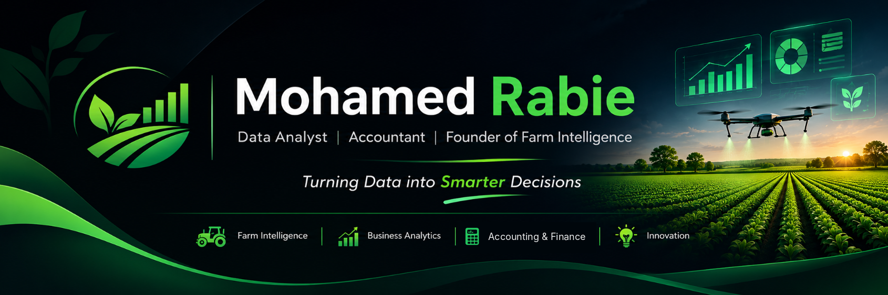

## About Me
- Business Information Systems student, Mansoura, Egypt
- Focus: accounting, finance, and data analytics
- Building Farm Intelligence (Next.js, Supabase)

## Stats

## Skills
Excel | SQL Server | Power BI | Python

## Projects
- **[construction-contracts-financial-dashboard](https://github.com/Mo7Rabie/construction-contracts-financial-dashboard)**: Interactive Power BI dashboard for analyzing the financial performance of construction contracts.
- **[Farm Intelligence](https://github.com/Mo7Rabie/farm-intelligence)**: Multi-tenant cloud platform for farm management and analytics (Next.js, Supabase).

## Connect
[LinkedIn](https://www.linkedin.com/in/mohamed-rabie-9a00b2386/)
